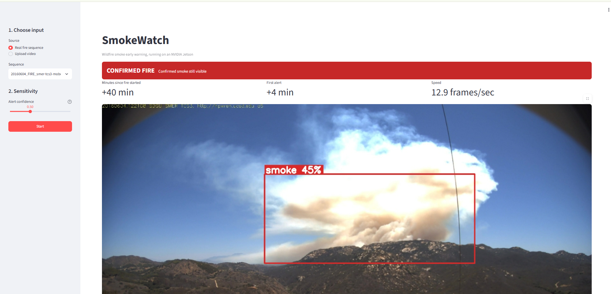
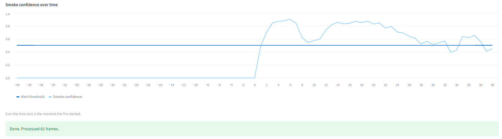
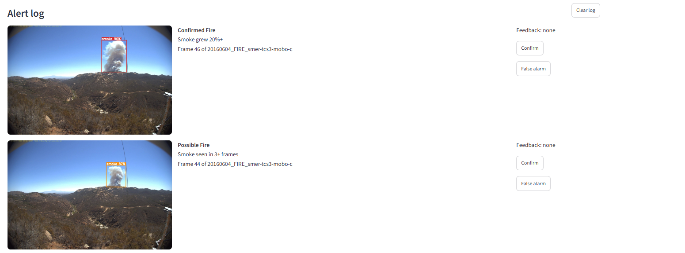

# SmokeWatch

Edge AI wildfire smoke early warning that runs on an NVIDIA Jetson.

A YOLOv8n model detects smoke and fire in camera frames. A rule engine turns
those detections into an alert level, and a Streamlit dashboard shows the result.
Running on the Jetson means remote towers with weak internet do not need to
stream video to the cloud.

Course: Special Topics in Data Science (UMBC). Individual project.

## Docker image

`ultralytics/ultralytics:latest-jetson-jetpack6` (JetPack 6, with PyTorch 2.10, Ultralytics 8.4.210,
OpenCV 4.11 and NumPy 1.26 built to work together). Streamlit and pytest are added on top
(see `Dockerfile` and `requirements.txt`).

## Project layout

```
backend/
  rules.py      alert rules (persistence, growth, exclusion zones, uncertainty)
  detector.py   YOLO wrapper, frame quality check, box drawing
  pipeline.py   frames in, status + annotated frame out, alerts saved
  store.py      SQLite alert log and user feedback
frontend/
  app.py        Streamlit dashboard
scripts/
  train.py            fine-tune YOLOv8n on D-Fire, export to TensorRT
  run_sequence.py     run the backend from the command line
  make_video.py       turn an image sequence into an MP4 to test video upload
  convert_weights.py  only needed with older Ultralytics versions than the training one
docs/images/        dashboard screenshots
tests/              unit tests for the rules, pipeline and dashboard helpers
data/dfire.yaml     dataset config
requirements.txt
Dockerfile
```

## Decision logic

| Level | When |
|---|---|
| Clear | no confident smoke |
| Watch | smoke with confidence 0.3 to 0.5, logged only |
| Possible Fire | **Rule 1:** smoke with confidence 0.5+ in the same area for 3+ frames |
| Confirmed Fire | **Rule 2:** that smoke grows 20%+ in area over 5 frames, or fire appears inside it. Stays confirmed while the smoke is visible |
| Feed issue | frame is too dark or frozen, so the system does not claim "no smoke" |

**Rule 3:** smoke inside user-defined exclusion zones (chimneys, dusty roads) is
logged but never raises an alert. A smoke track survives up to 2 missed frames.

## Setup on the Jetson

```bash
cd /home/jetson/Desktop/jetson_labs
git clone https://github.com/Kenil-Nakrani/smokewatch.git
cd smokewatch

# one time: download the image and start a container named smokewatch
docker pull ultralytics/ultralytics:latest-jetson-jetpack6
docker run -d --name smokewatch --runtime nvidia --network host --ipc=host --restart unless-stopped \
  -v /home/jetson/Desktop/jetson_labs:/home/jetson_labs -w /home/jetson_labs/smokewatch \
  ultralytics/ultralytics:latest-jetson-jetpack6 sleep infinity
docker exec smokewatch useradd -u 1000 -m -s /bin/bash jetson
docker exec smokewatch pip install --no-cache-dir -r requirements.txt
```

Shortcut for the commands below (run it once per terminal session):

```bash
SW="docker exec -u $(id -u):$(id -g) -e HOME=/tmp -e PYTHONUNBUFFERED=1 smokewatch"
```

Put the trained model at `weights/best.pt` (weights are not stored in git).

## Usage

```bash
$SW python3 -m pytest -q
$SW python3 scripts/run_sequence.py data/figlib/20160604_FIRE_smer-tcs3-mobo-c --weights weights/best.pt
```

Dashboard (the container uses host networking, so no port mapping is needed):

```bash
$SW python3 -m streamlit run frontend/app.py --server.address 0.0.0.0 --server.port 8501 --server.headless true --browser.gatherUsageStats false
```

Open `http://<jetson-ip>:8501` in a browser on your laptop.

## Dashboard

- **Input:** pick a real fire sequence from `data/figlib/`, or upload a video.
- **Sensitivity:** one slider for the alert confidence (lower alerts sooner, with more false alarms).
- **Status bar:** Clear, Watch, Possible Fire, Confirmed Fire or Feed issue, with the reason.
- **Numbers:** minutes since the fire started (from FIgLib file names), time of the first alert, and processing speed in frames per second.
- **Image:** the camera frame with smoke and fire boxes, colored by alert level.
- **Chart:** smoke confidence over time against the alert threshold.
- **Alert log:** snapshot of every alert with Confirm and False alarm buttons, plus Clear log.

Running on a real wildfire (HPWREN FIgLib sequence `20160604_FIRE_smer-tcs3-mobo-c`):



Smoke confidence stays near 0 for the 40 minutes before ignition and crosses the alert threshold right after the fire starts (0 on the time axis):



Alert log with snapshots and feedback buttons:



To test the **Upload video** option, turn a fire sequence into a video first:

```bash
$SW python3 scripts/make_video.py data/figlib/20160604_FIRE_smer-tcs3-mobo-c data/videos/fire_smer.mp4
```

## Model

YOLOv8n fine-tuned on D-Fire in Google Colab (T4 GPU, 32 epochs, 2 hours).

Validation results on the D-Fire val split (3,099 images):

| Class | mAP50 | mAP50-95 |
|---|---|---|
| all | 0.756 | 0.434 |
| smoke | 0.810 | 0.494 |
| fire | 0.703 | 0.374 |

## Results on a real fire (on the Jetson)

HPWREN FIgLib sequence `20160604_FIRE_smer-tcs3-mobo-c`: 81 frames, one per minute,
from 40 minutes before to 40 minutes after ignition.

| Measure | Result |
|---|---|
| False alarms in the 40 minutes before ignition | 0 |
| First Watch (low-confidence smoke) | 1 minute after ignition |
| Possible Fire (Rule 1) | 4 minutes after ignition |
| Confirmed Fire (Rule 2) | 6 minutes after ignition |

Download the sequence into `data/figlib/` with:

```bash
mkdir -p data/figlib/20160604_FIRE_smer-tcs3-mobo-c && cd data/figlib/20160604_FIRE_smer-tcs3-mobo-c
wget -q -r -l1 -np -nd -A jpg https://cdn.hpwren.ucsd.edu/HPWREN-FIgLib-Data/20160604_FIRE_smer-tcs3-mobo-c/index.html
```

## Lessons learned

The first version ran in the course container (`nvcr.io/nvidia/l4t-ml:r36.2.0-py3`). Its NumPy 2
clashed with its OpenCV and PyTorch, and patching around that mixed library versions that
corrupted memory and crashed the dashboard. Moving to the official Ultralytics Jetson image,
where all libraries are built to match, fixed it.

## Data

- Training: [D-Fire](https://github.com/wizbeans/FireDataset), about 21,500 labeled smoke and fire images,
  downloaded in Colab from the Kaggle copy `sayedgamal99/smoke-fire-detection-yolo`
  (14,122 train, 3,099 val, 4,306 test images).
- Testing: [HPWREN FIgLib](https://www.hpwren.ucsd.edu/FIgLib/), real camera sequences covering
  40 minutes before and after ignition.

Datasets and model weights are not stored in git (see `.gitignore`).

## Status

- [x] Alert rule engine with unit tests
- [x] Backend pipeline, SQLite alert log, command-line runner
- [x] Fine-tune the model on D-Fire (Colab)
- [x] Run the backend on a real fire sequence on the Jetson
- [x] Simple Streamlit dashboard
- [ ] Evaluate on more FIgLib sequences
- [ ] Live camera input
