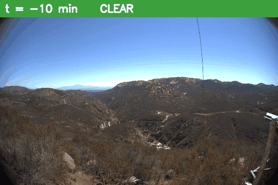

# SmokeWatch

Wildfire smoke early warning that runs on an NVIDIA Jetson.

A camera image goes in, a YOLO model finds smoke, and if the smoke keeps showing up
and growing, SmokeWatch raises an alert. Everything runs on the Jetson, so a remote
camera tower does not need fast internet.



*Real wildfire camera footage (HPWREN FIgLib). The top bar shows minutes since the fire started and the alert level.*

## How it decides

| Level | When |
|---|---|
| Clear | no smoke |
| Watch | weak smoke signal, only logged |
| Possible Fire | smoke in the same spot for 3 frames in a row |
| Confirmed Fire | that smoke grows by 20% or more, or fire appears inside it |

## Results on a real fire

Tested on 81 real camera frames, one per minute, from 40 minutes before to 40 minutes after a fire started.

| | Result |
|---|---|
| False alarms before the fire | 0 |
| Possible Fire | 4 minutes after the fire started |
| Confirmed Fire | 6 minutes after the fire started |
| Speed on the Jetson | about 13 frames per second |

The model is YOLOv8n trained on about 21,500 smoke and fire images ([D-Fire](https://github.com/wizbeans/FireDataset)). Smoke detection score: 0.81 mAP50.

## Dashboard


Smoke confidence over time. It stays at 0 until the fire starts (0 on the time axis), then crosses the alert line:


Every alert is saved with a snapshot, and a person can mark it as Confirm or False alarm:


Inputs: a real fire sequence, an uploaded video, or a live USB camera.

## How to run

Docker image: `ultralytics/ultralytics:latest-jetson-jetpack6`

One-time setup on the Jetson:

```bash
git clone https://github.com/Kenil-Nakrani/smokewatch.git
cd smokewatch
docker run -d --name smokewatch --runtime nvidia --network host --ipc=host --restart unless-stopped \
  -v /dev:/dev --device-cgroup-rule='c 81:* rmw' \
  -v $(pwd):/app -w /app ultralytics/ultralytics:latest-jetson-jetpack6 sleep infinity
docker exec smokewatch pip install --no-cache-dir -r requirements.txt
```

Put the trained model at `weights/best.pt`, then start the dashboard:

```bash
docker exec smokewatch python3 -m streamlit run frontend/app.py --server.address 0.0.0.0 --server.port 8501
```

Open `http://<jetson-ip>:8501` in a browser.

## Project files

- `backend/` detection and alert rules
- `frontend/app.py` the Streamlit dashboard
- `scripts/` training, testing on image folders, and making the GIF
- `tests/` unit tests (`docker exec smokewatch python3 -m pytest`)

## Data

- Training: [D-Fire](https://github.com/wizbeans/FireDataset) smoke and fire images
- Testing: [HPWREN FIgLib](https://www.hpwren.ucsd.edu/FIgLib/) real wildfire camera sequences
